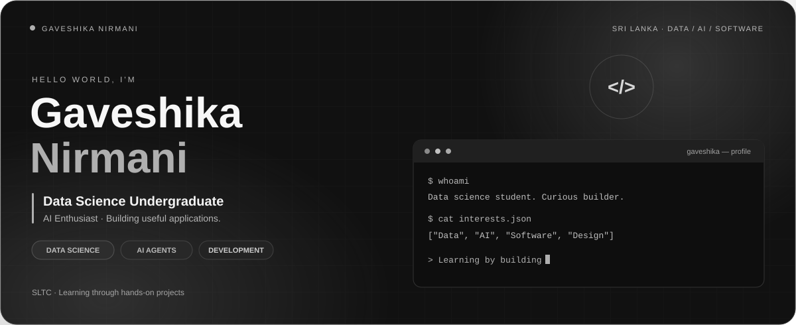

<a href="https://github.com/gavinirmani/Gavi-2.0-AI-Agent">Gavi 2.0</a> ·
<a href="https://github.com/gavinirmani/smartcare_hospital_system">SmartCare</a> ·
<a href="https://github.com/gavinirmani/Student-Record-Management-System">Student Records</a> ·
<a href="https://github.com/gavinirmani/todo-list-app">To-Do List</a> ·
<a href="https://github.com/gavinirmani/gavinirmani.github.io">Portfolio repository</a> ·
<a href="https://github.com/gavinirmani/Internship_Project">Internship Project</a>

<a href="https://gavinirmani.github.io/">Visit my portfolio</a> ·
<a href="https://www.linkedin.com/in/gaveshika-nirmani-827443301/">Connect on LinkedIn</a>

Read the text version

## About

I'm **Gaveshika Nirmani**, a Data Science undergraduate at **SLTC, Sri Lanka**, with interests in artificial intelligence, analytics, and software development. I learn through hands-on projects, from database-backed REST APIs to desktop applications and AI assistants.

My focus is on strengthening my technical foundations while building applications that are useful, understandable, and thoughtfully designed.

- **Academic focus:** Data Science
- **Exploring:** AI agents, data analysis, and visualization
- **Project experience:** Backend APIs, web applications, and desktop software
- **Creative interests:** Visual design and clear technical communication

## Technology stack

**Languages**

**Web, backend & databases**

**Analytics, development & design tools**

## Selected projects

| Project | Overview | Technologies |
| :--- | :--- | :--- |
| **[Gavi 2.0 — AI Agent](https://github.com/gavinirmani/Gavi-2.0-AI-Agent)** | Personal AI assistant with task and note management, calculation tools, persistent memory, and web and terminal interfaces. | Python, FastAPI, Gemini API |
| **[SmartCare — Hospital Management](https://github.com/gavinirmani/smartcare_hospital_system)** | REST API backend covering patients, doctors, appointments, admissions, lab tests, and billing, with layered architecture and centralized exception handling. | Java, Spring Boot, MySQL |
| **[Student Record Management](https://github.com/gavinirmani/Student-Record-Management-System)** | Desktop application for creating, updating, searching, and managing student records with validation and TXT/CSV storage. | Python, Tkinter, CSV |
| **[To-Do List App](https://github.com/gavinirmani/todo-list-app)** | Responsive task manager with task editing, completion tracking, and browser local storage. | HTML, CSS, JavaScript |
| **[Personal Portfolio](https://github.com/gavinirmani/gavinirmani.github.io)** | Personal website showcasing my skills, projects, and background. [Visit website](https://gavinirmani.github.io/) | HTML, CSS, JavaScript, GitHub Pages |
| **[Internship Project — Data Analysis](https://github.com/gavinirmani/Internship_Project)** | Three levels of data cleaning, preprocessing, exploratory and statistical analysis, and visualization tasks. | Python, Jupyter Notebook, Pandas, NumPy, Matplotlib, Seaborn |

[Explore all repositories →](https://github.com/gavinirmani?tab=repositories)

## Learning & development

- **Data & analytics:** Strengthening Python, SQL, and Power BI skills to communicate insights clearly.
- **Artificial intelligence:** Exploring tool use, memory, and practical workflows in AI agents.
- **Software engineering:** Improving API design, database modeling, validation, and maintainability.

## Connect

Visit my **[portfolio](https://gavinirmani.github.io/)** to explore my work, or connect with me on **[LinkedIn](https://www.linkedin.com/in/gaveshika-nirmani-827443301/)**.

---

Gaveshika Nirmani · Data Science · AI · Software Development

